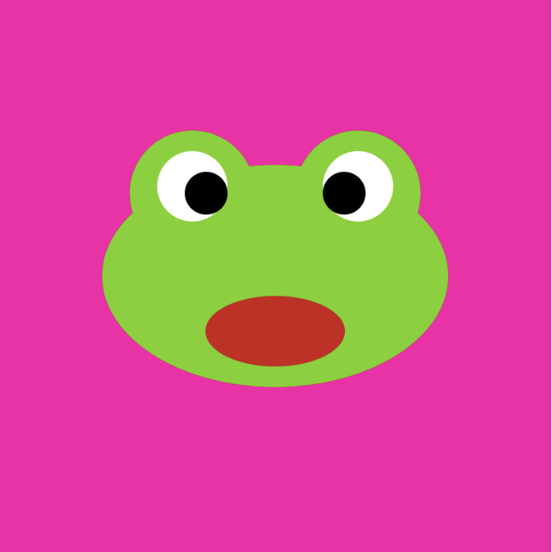
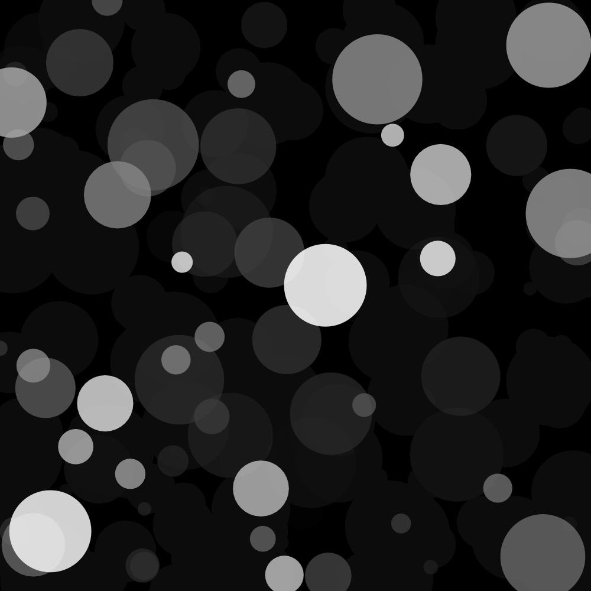

# Week 01 — Introduction to Creative Coding

<!-- Replace ## with the week number and Topic Name with the week's focus -->
<!-- You may also refer to each week's slide for the Topic Name -->
<!-- e.g. Week 03 — Arrays & Functions -->

---

### Activities

| Activity | What I Made                   |
| -------- | ----------------------------- |
| `1a`     | Cute Frog using basic shapes  |
| `1b`     | Polka Dot                     |

<!-- Add or remove rows to match the activities for this week. -->

---

### This Week
<!-- A short, informal summary of what you explored across the week's activities. What did you make? What clicked? What didn't?
     A few sentences is all you need — write it like a journal entry, not a report. -->
     
     This week, I explored drawing with basic shapes in p5.js. I made a cute frog and experimented with randomly generated circles. It was interesting to see how simple changes to size, position and colour could create different results. I also explored how the frame rate affects how quickly new circles appear. I’m still getting used to the code, but seeing the visual results helped me understand what each line does.

---

### Output
<!-- Drop a screenshot, photo, or GIF of something you made this week.
     Save it to a readme-assets/ folder inside this week's folder.
     Made more than one thing worth showing? Add more images. -->
     
     
     
     