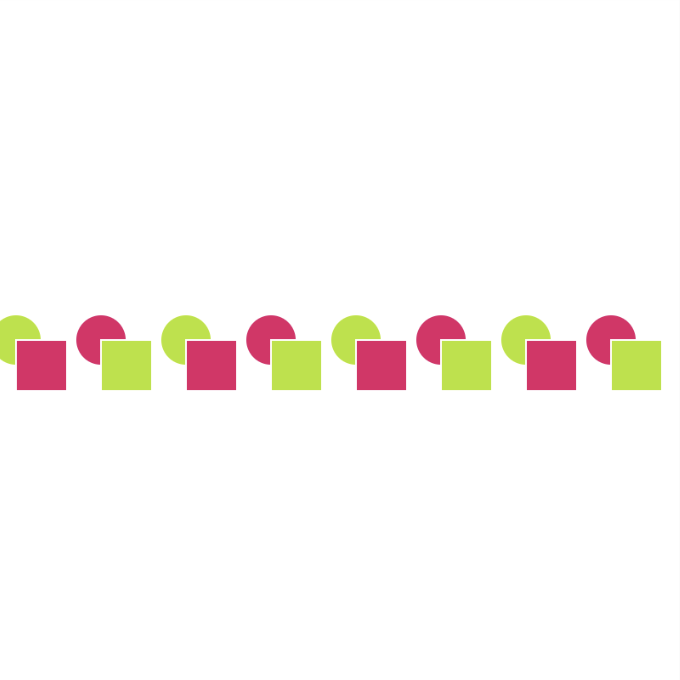

# Week 02 — Control Flows and Interactivity

<!-- Replace ## with the week number and Topic Name with the week's focus -->
<!-- You may also refer to each week's slide for the Topic Name -->
<!-- e.g. Week 03 — Arrays & Functions -->

---

### Activities

| Activity | What I Made                   |
| -------- | ----------------------------- |
| `2a`     | Mode Switch                   |
| `2b`     | Pattern Making                |

<!-- Add or remove rows to match the activities for this week. -->

---

### This Week

<!-- A short, informal summary of what you explored across the week's activities. What did you make? What clicked? What didn't?
     A few sentences is all you need — write it like a journal entry, not a report. -->
     
     This week, I explored conditionals and loops in p5.js. I learnt how conditions can make a sketch respond differently depending on the selected mode, while loops repeat shapes without having to draw each one individually.
     
---

### Output

<!-- Drop a screenshot, photo, or GIF of something you made this week.
     Save it to a readme-assets/ folder inside this week's folder.
     Made more than one thing worth showing? Add more images. -->

     
     
     