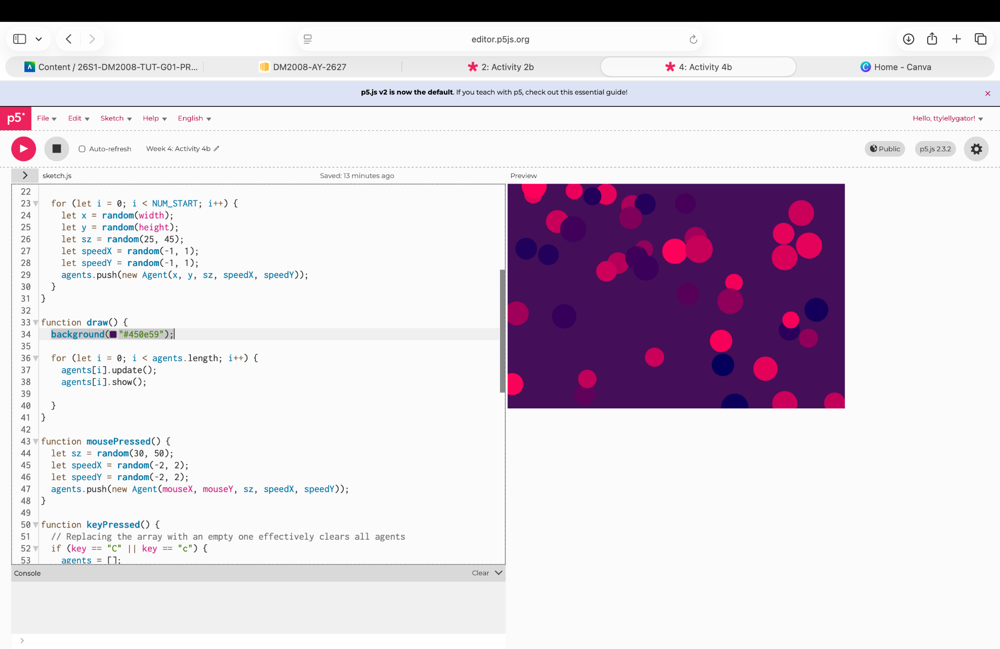
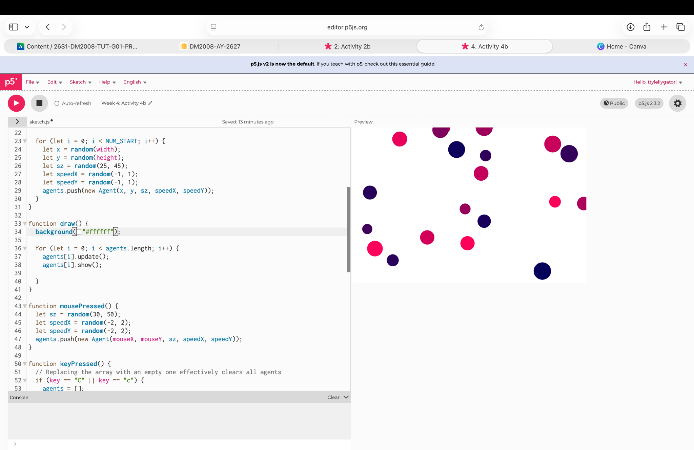

# Week 04 — Object-oriented Programming (Part I)

<!-- Replace ## with the week number and Topic Name with the week's focus -->
<!-- You may also refer to each week's slide for the Topic Name -->
<!-- e.g. Week 03 — Arrays & Functions -->

---

### Activities

| Activity | What I Made                                    |
| -------- | ---------------------------------------------- |
| `4a`     | Bake a Chocolate, Vanilla & Strawberry Cookie  |
| `4b`     | Objects in Motion                              |

<!-- Add or remove rows to match the activities for this week. -->

---

### This Week

<!-- A short, informal summary of what you explored across the week's activities. What did you make? What clicked? What didn't?
     A few sentences is all you need — write it like a journal entry, not a report. -->

     This week, I explored classes and objects in p5.js. I also explored using an array to manage multiple moving objects. Working with class to create moving objects was quite confusing to me and I’m still trying to understand how the constructor, properties and methods work together... sigh.
---

### Output

<!-- Drop a screenshot, photo, or GIF of something you made this week.
     Save it to a readme-assets/ folder inside this week's folder.
     Made more than one thing worth showing? Add more images. -->

     
     
     
     

---

<!-- ─────────────────────────────────────────────────────
     GOING FURTHER — if you want to document more, here are some ideas:

     ### 🧩 Something I Found Interesting
     A line of code, a technique, a happy accident — paste it here.
     function draw() {
     background("#450e59");

     When I was experimenting with background colours, the purple made some circles blend into the background, t. Switching to white made all the circles easier to see. I found it interesting how changing just the background could make outcome look so different.