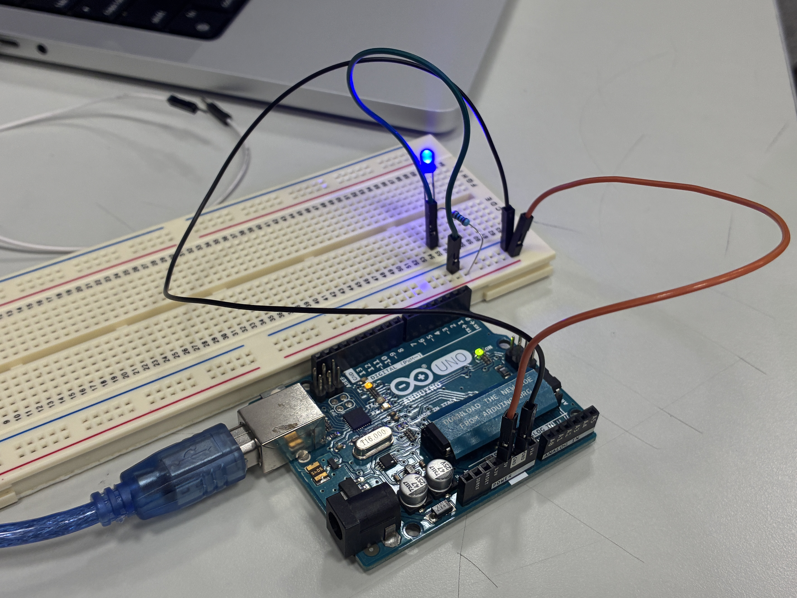

# Week 08 — Arduino Basics

<!-- Replace ## with the week number and Topic Name with the week's focus -->
<!-- You may also refer to each week's slide for the Topic Name -->
<!-- e.g. Week 03 — Arrays & Functions -->

---

### Activities

| Activity | What I Made                   |
| -------- | ----------------------------- |
| `8a`     | Light it Up                   |
| `8b`     | Sensor Check                  |

<!-- Add or remove rows to match the activities for this week. -->

---

### This Week

<!-- A short, informal summary of what you explored across the week's activities. What did you make? What clicked? What didn't?
     A few sentences is all you need — write it like a journal entry, not a report. -->

     This week, I learnt how to connect and control an LED using Arduino and a breadboard. I explored how to keep the LED constantly on, switch it on and off using digital output, and adjust its brightness using PWM. This helped me understand how code can control physical components, beyond creating visuals on a screen.

     * I did not record anything for Activity 8b: Sensor Check and also the code isn't with me...
     
---

### Output

<!-- Drop a screenshot, photo, or GIF of something you made this week.
     Save it to a readme-assets/ folder inside this week's folder.
     Made more than one thing worth showing? Add more images. -->

     
     
     
     