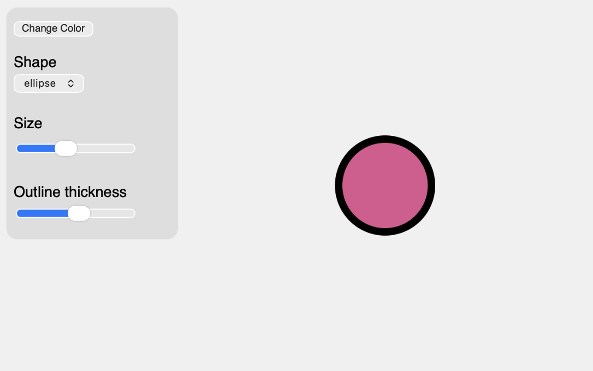
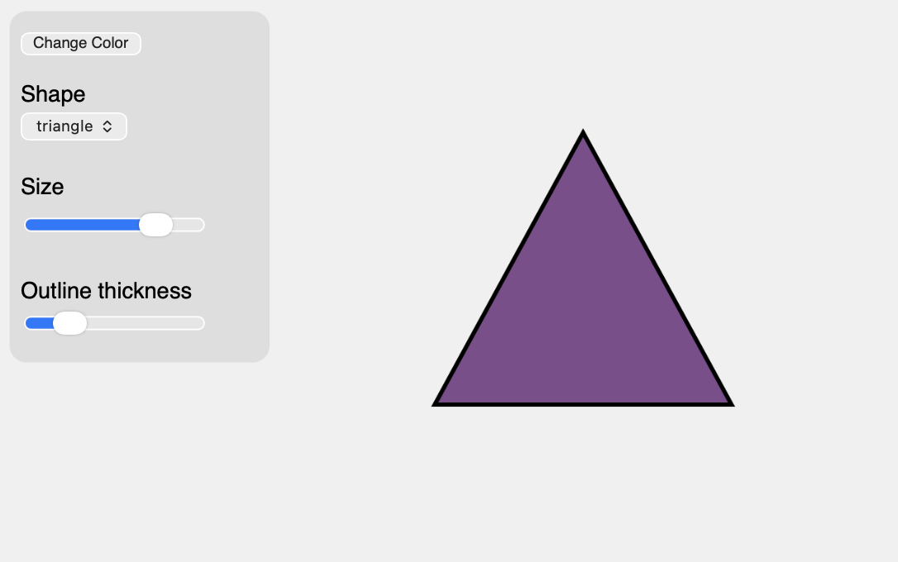

# Week 10 — Control Center

<!-- Replace ## with the week number and Topic Name with the week's focus -->
<!-- You may also refer to each week's slide for the Topic Name -->
<!-- e.g. Week 03 — Arrays & Functions -->

---

### Activities

| Activity | What I Made                   |
| -------- | ----------------------------- |
| `10`     | Control Center                |

<!-- Add or remove rows to match the activities for this week. -->

---

### This Week

<!-- A short, informal summary of what you explored across the week's activities. What did you make? What clicked? What didn't?
     A few sentences is all you need — write it like a journal entry, not a report. -->

     I enjoyed exploring the use of buttons, sliders and a dropdown to change a shape’s colour, size and outline thickness. I also rearranged the controls, made the fonts consistent and added a background panel to make the interface look neater. This helped me understand how layout and styling can make controls easier to use.
     
---

### Output

<!-- Drop a screenshot, photo, or GIF of something you made this week.
     Save it to a readme-assets/ folder inside this week's folder.
     Made more than one thing worth showing? Add more images. -->

     
     
     