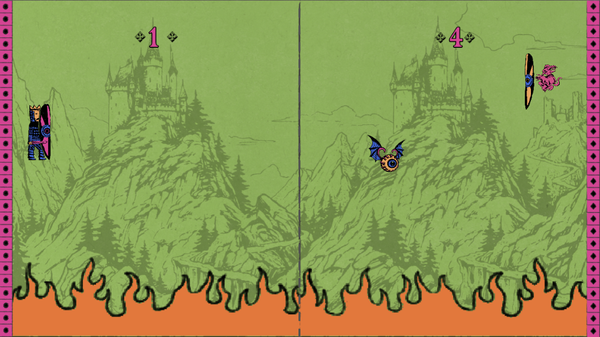
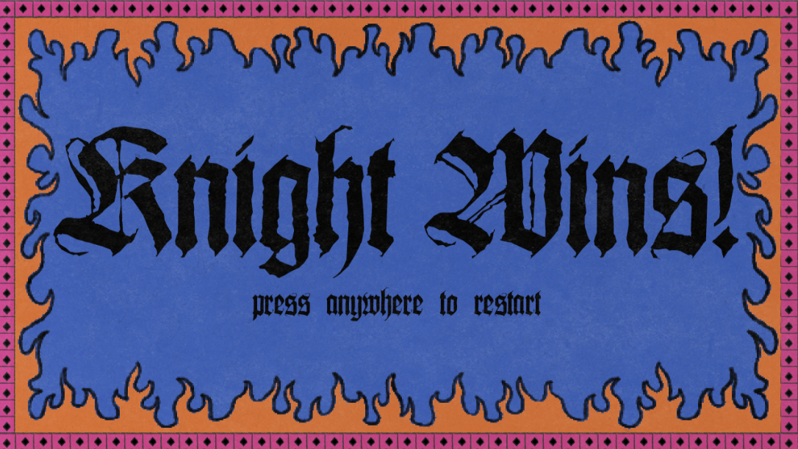
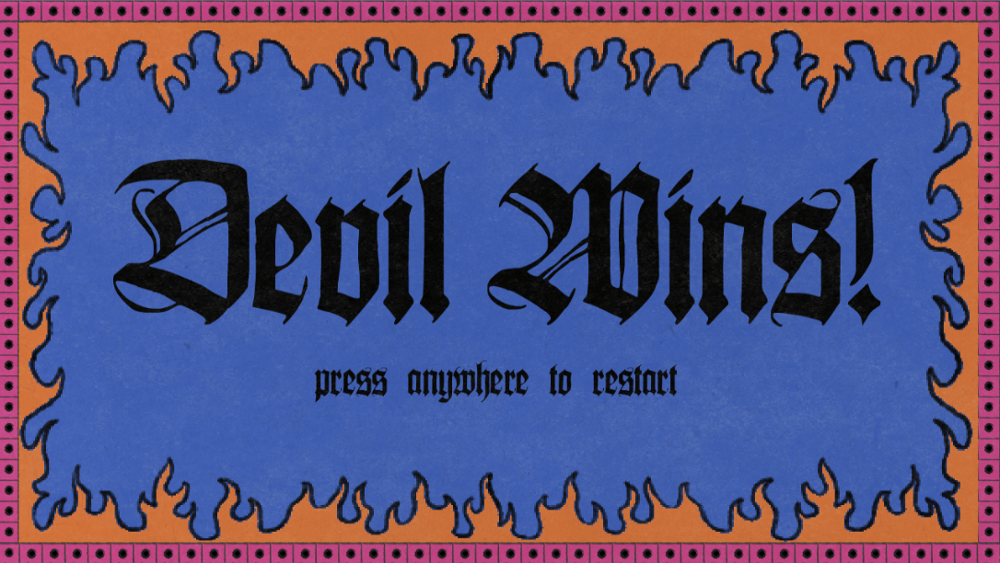

# Mini Project — Medieval Pong

<!-- Replace "Title" with the name of your project, e.g. "Mini Project — Pong Remix" -->

---

### The Project

<!-- What did you build and what makes it yours? A few sentences is enough.
     What did you change, add, or push beyond the scaffold? -->

     We created Medieval Pong, a two-player game featuring a Knight and a Devil battling on a medieval-themed court. We customised the starter scaffold with character paddles, sound effects and an eyeball that changes its facing direction as it moves left or right. We also added score tracking and separate winning screens for each character, with the first player to reach five points winning the game.

---

### Output

<!-- Drop a screenshot or GIF of your finished project.
     Save it to a readme-assets/ folder inside this project folder.
     Got more than one good screenshot? Add them. -->

     
     
     
     

     [Watch Online](https://editor.p5js.org/ttylellygator/full/axGUELzCT)

<!-- Replace the link above with a URL to a screen recording or video of your project.
     ⚠️ Make sure the file or page is set to public before submitting. -->

---

### ✍️ Reflection

<!-- 200–300 words on your process. Write freely — this isn't an essay.
     Some prompts to get you started:
     — What did you set out to make, and how did the result compare?
     — What inputs does your sketch respond to, and how did you approach that?
     — What was your biggest challenge, and how did you work through it?
     — What would you push further if you had more time? -->

     In this project, I collaborated with Z to create a Medieval Pong game using p5.js. We wanted to turn the basic Pong scaffold into a battle between a Knight and a Devil through themed visuals and sound. 
     
     My main contributions were adding sound effects, creating the directional eyeball feature, and testing and debugging the game. I added sounds for paddle hits, missed balls and winning. However, getting the audio to load and play properly was challenging and required repeated troubleshooting.
     
     For the eyeball, I used two images that change depending on whether it travels left or right. This small detail made the exchange between the characters feel more like a battle and helped strengthen our theme.
     
     One of the biggest challenges was combining our work as we could not edit the same sketch together in real time like Google Docs. We had to go back and forth sending the code folder to each other and communicate our changes clearly to avoid conflicting code. Keeping track of the latest version and checking that our changes worked together became tedious and time-consuming for us.
     
     With more time, I would refine the collision detection and add more visuals to enhance the experience.