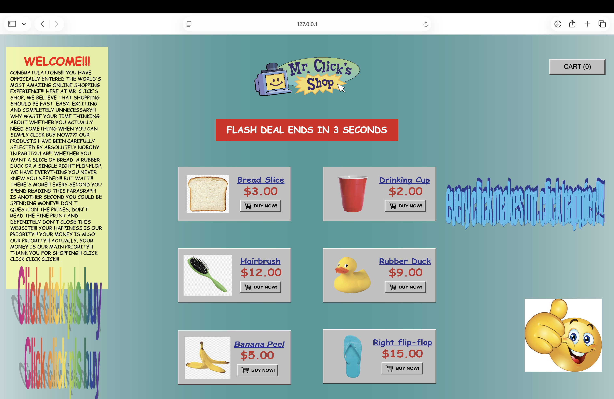
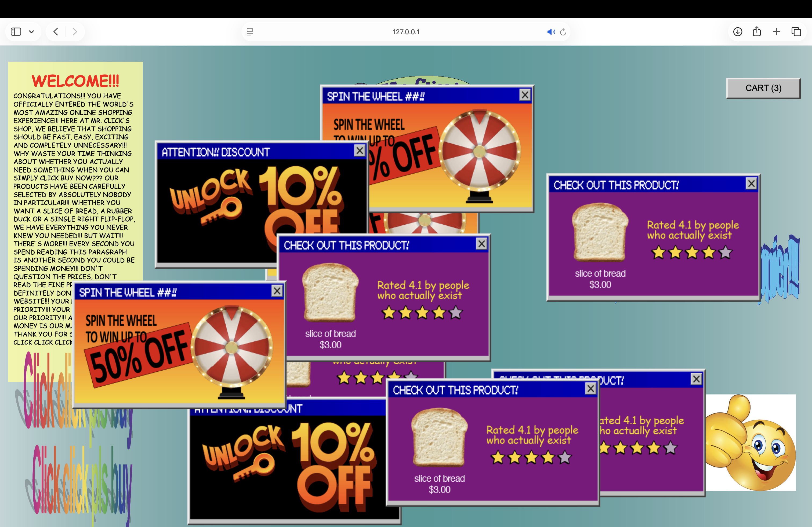
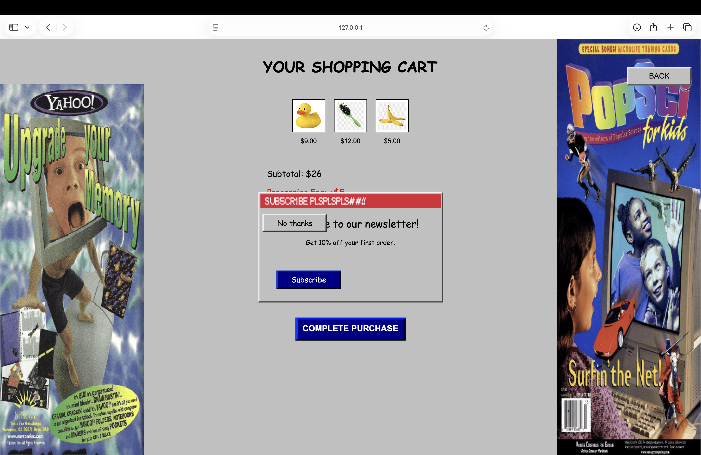
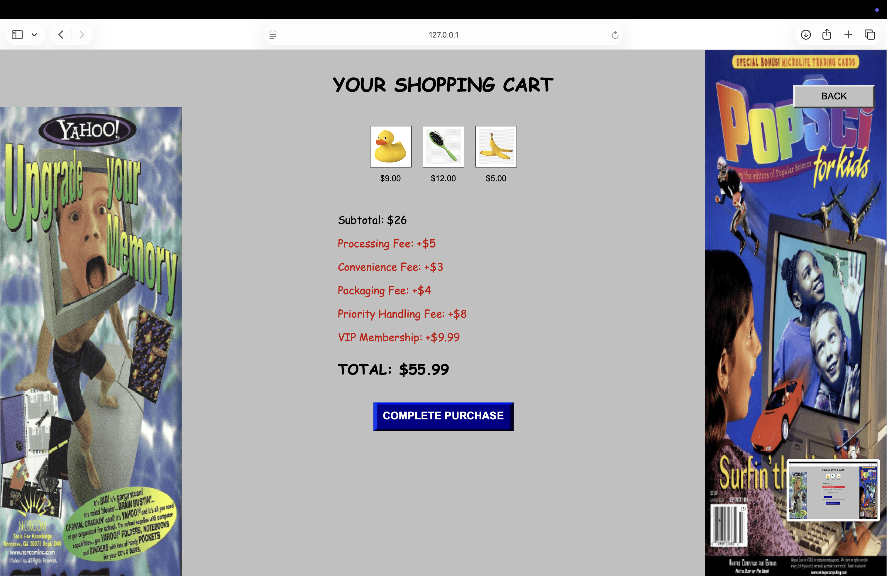
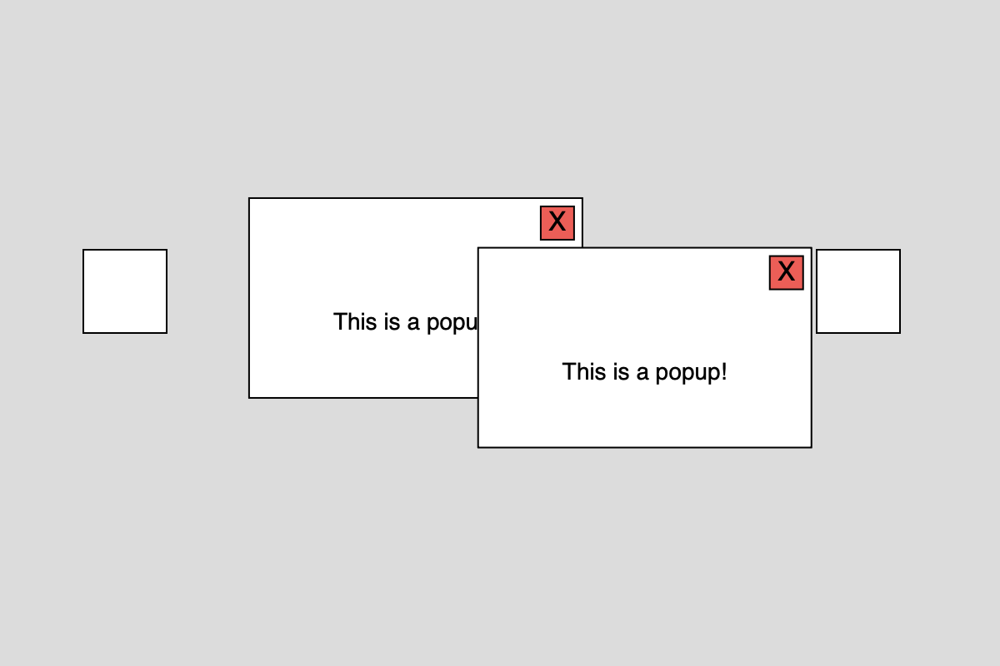

# Final Project — Mr. Click's Shop

<!-- Replace "Title" with the name of your project -->

---

### The Project

<!-- What is your project and what does it do?
     What experience does it create, and who or what does it respond to?
     A short paragraph is ideal — make it something you'd be happy for anyone to read. -->

     Mr. Click's Shop is an ironic online shopping website created using p5.js. The project explores poor user interface design and dark patterns by intentionally creating a frustrating and chaotic shopping experience.
     
     Inspired by early 2000s websites, it features exaggerated graphics, random pop-ups, disappearing products, hidden fees and misleading interactions. These elements deliberately go against conventional user-friendly design principles.
     
     Through this project, we aim to highlight how online shopping websites can use manipulative design tactics to pressure users into making decisions.

---

### Output

<!-- Drop a screenshot or GIF of your project.
     Got more to show? Add more images — let the work speak for itself.
     Save everything to a readme-assets/ folder inside this project folder. -->

     
     
     
     
     

     [Watch Online](http://127.0.0.1:5500/index.html)

<!-- Replace the link above with a URL to a screen recording or video of your final project.
     ⚠️ Make sure the file or page is set to public before submitting. -->

---

### ✍️ Reflection

<!-- 200–300 words on your process and outcome. Write freely — this is your story to tell.
     Some prompts to get you started:
     — What did you set out to create, and how did the final result compare to your original vision?
     — How is your project structured — what inputs does it respond to and how did you approach the code?
     — What were your key visual and/or sonic design decisions, and why?
     — What was your biggest challenge, and how did you work through it?
     — What would you change, add, or explore further given more time? -->

     We started out with a rough layout of how we wanted our website to look and function which can be seen in: . Our initial idea was to create an online shopping website that incorporates poor user interface design and dark patterns to intentionally frustrate users. As we developed the project, we explored different ways to make the shopping experience increasingly chaotic and misleading.

     For our visual direction, we took inspiration from early 2000s websites, using exaggerated graphics, cluttered layouts and Windows-style pop-ups. We also incorporated sound effects to make the interactions more overwhelming and irritating. I particularly enjoyed this part of the project as it allowed me to experiment with unconventional design choices!
     
     One of our biggest challenges was making sure the different interactions worked together without interfering with one another. For example, we had to adjust the timing and positioning of our pop-ups so they would appear randomly while still allowing users to interact with the website. Through trial and error, we gradually improved the functionality and overall user experience.

     Overall, our final website developed beyond our initial rough layout into a more interactive and chaotic experience. One feedback we received was to explore what happens when users click on the pop-ups, rather than only allowing them to close them. Given more time, we could introduce unexpected outcomes when users interact with these pop-ups, making the experience more unpredictable and further reinforcing our concept of dark patterns.